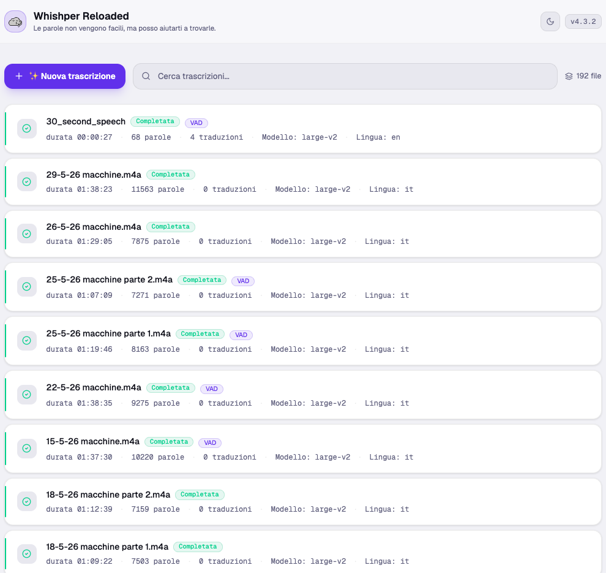
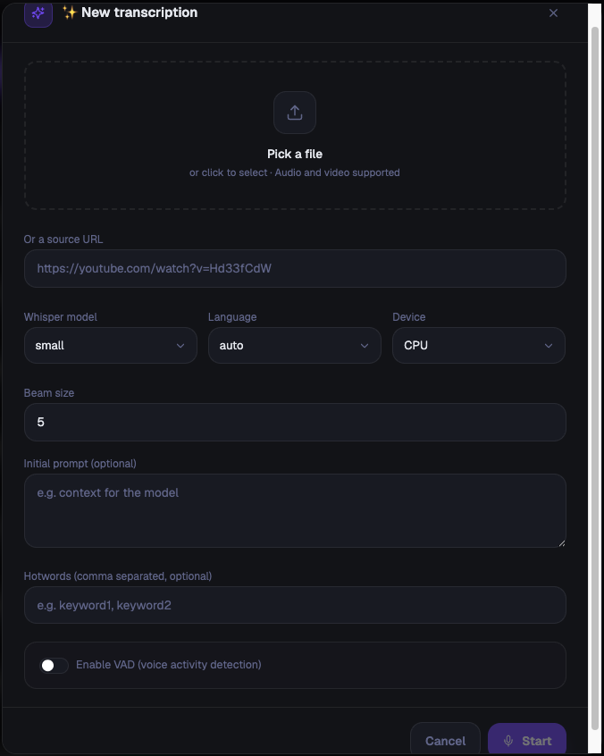
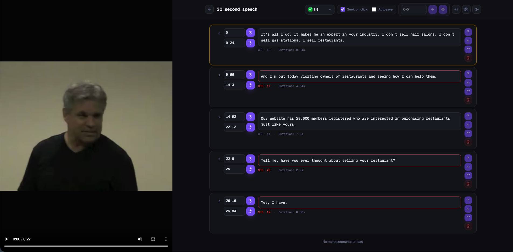
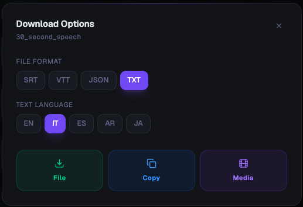
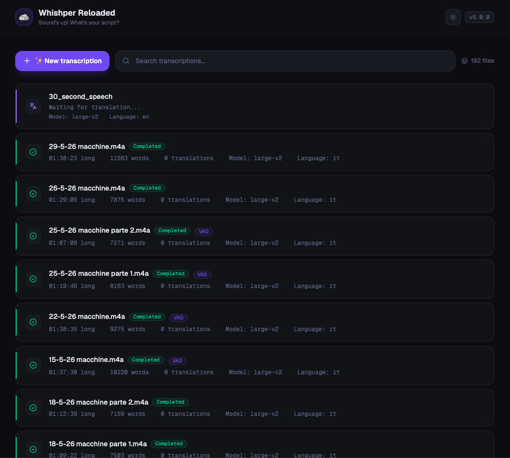

[](#whishper-reloaded--self-hosted-audio-transcription--subtitle-editor-100-local-whisper)

# Whishper Reloaded — Self-Hosted Audio Transcription & Subtitle Editor (100% Local, Whisper)

[](https://hub.docker.com/r/thespartan94/whishper-frontend)
[](https://github.com/DevDema/whishper-reloaded/stargazers)
[](https://github.com/DevDema/whishper-reloaded/blob/main/LICENSE)
[](https://github.com/DevDema/whishper-reloaded/commits/main)
[](https://github.com/awesome-selfhosted/awesome-selfhosted)

**Whishper Reloaded** is an open-source, **self-hosted audio transcription** suite with a full **web UI**.
Powered by **OpenAI Whisper** (Faster-Whisper), it runs **100% locally** — no cloud, no data leakage.
Transcribe, translate, and edit subtitles in SRT/VTT/TXT format from any audio or video file.

> **Project status:** This project began as [Whishper](https://github.com/pluja/whishper) by [Pluja](https://github.com/pluja), who remains the original creator and main contributor of the core idea and codebase. Whishper Reloaded is now maintained solo by me, [devdema](https://github.com/devdema), going forward. If you find this useful, please consider supporting the original project too.

## Table of Contents

- [Features](#features)
- [Quick Start](#quick-start)
- [Running with Docker](#running-with-docker)
- [Screenshots](#screenshots)
- [Comparison with Alternatives](#comparison-with-alternatives)
- [FAQ](#faq)
- [Contributing](#contributing)
- [Credits](#credits)

## Features

Everything from the original Whishper, plus a set of improvements added in this fork.

### Core features

- [x] 🗣️ **Transcribe any media** to text: audio, video, etc.
  - Transcribe from URLs (any source supported by yt-dlp).
  - Upload a file to transcribe.
- [x] 📥 **Download transcriptions in many formats**: TXT, JSON, VTT, SRT or copy the raw text to your clipboard.
- [x] 🌐 **Translate your transcriptions** to any language supported by [Libretranslate](https://libretranslate.com).
- [x] ✍️ **Powerful subtitle editor** so you don't need to leave the UI!
  - Transcription highlighting based on media position.
  - CPS (Characters per second) warnings.
  - Segment splitting.
  - Segment insertion.
  - Subtitle language selection.
- [x] 🏠 **100% Local**: transcription, translation and subtitle edition happen 100% on your machine (can even work offline!).
- [x] 🚀 **Fast**: uses FasterWhisper as the Whisper backend: get much faster transcription times on CPU!
- [x] 👍 **Quick and easy setup**: use the quick start script, or run through a few steps!
- [x] 🔥 **GPU support**: use your NVIDIA GPU to get even faster transcription times!
- [x] 🐎 **CPU support**: no GPU? No problem! Whishper can run on CPU too.

### What's new in Whishper Reloaded

- [x] **Decoupled containers**: run backend, frontend and whishper-api as separate containers ([DockerHub frontend](https://hub.docker.com/r/thespartan94/whishper-frontend), [DockerHub backend](https://hub.docker.com/r/thespartan94/whishper-backend)). Useful if your powerful transcription machine is not always on and you need the service available at all times!
- [x] **Search bar** to find specific transcriptions.
- [x] **Better page loading** through pagination, avoiding blocking UI threads that made browsers lag.
- [x] **Feedback banners** on connections to available services, with a more fail-tolerant approach to translations and new transcriptions.
- [x] **Rename transcriptions** after a successful transcription.
- [x] **Import/Export via JSON**: download the current transcription as JSON, edit it externally for pre-processing, and reupload it for real-time editing.
- [x] **Real-time editing improvements**:
  - [x] Audio-only mode for the Whishper editor.
  - [x] Playback shortcuts [F7, F8, F9].
  - [x] Navigate through segments using TAB.
  - [x] Go to current segment / navigate to a specific segment number.

## Quick Start

Get a full **self-hosted Whisper transcription** stack running with **Docker Compose** in a few steps:

```bash
# 1. Clone the repository
git clone https://github.com/DevDema/whishper-reloaded.git
cd whishper-reloaded

# 2. Create your .backend.env and .frontend.env files (see "Environment files" below)

# 3. Bring the whole stack up
docker compose up -d
```

The web UI will then be available at `http://localhost:3000`.

## Project structure

Whishper is a collection of pieces that work together. The main pieces are:

- **Transcription-API**: the API that runs Faster-Whisper. Found in the `transcription-api` folder.
- **Whishper-Backend**: the backend that coordinates frontend calls, database, and tasks. Found in the `backend` folder.
- **Whishper-Frontend**: the frontend (web UI) of the application. Found in the `frontend` folder.
- **Translation (3rd party)**: the LibreTranslate container used for translating subtitles.
- **MongoDB (3rd party)**: the database that stores all information about your transcriptions.
- **Nginx (3rd party)**: the proxy that allows running everything from a single domain.

## Running with Docker

Thanks to the decoupled architecture, you can run all the components on a single machine, or split them across several machines (for example, keeping the GPU-heavy `whishper-api` on a separate, occasionally-on machine while the rest of the stack stays always available).

### Docker Compose

The following `docker-compose.yml` runs the backend, MongoDB and frontend on the same server, while `whishper-api` is hosted on a different machine:

```yaml
services:
  whishper-mongo:
    image: mongo:latest
    container_name: whishper-mongo
    env_file:
      - .backend.env
    restart: unless-stopped
    volumes:
      - ./db_data/db:/data/db
      - ./db_data/logs/:/var/log/mongodb/
    environment:
      MONGO_INITDB_ROOT_USERNAME: ${DB_USER:-whishper}
      MONGO_INITDB_ROOT_PASSWORD: ${DB_PASS:-whishper}
    expose:
      - 27017
    ports:
      - 27017:27017
    command: mongod --logpath var/log/mongodb/mongod.log

  whishper-frontend:
    image: thespartan94/whishper-frontend:latest
    container_name: whishper-frontend
    ports:
      - "3000:3000"
    expose:
      - 3000
    env_file:
      - .frontend.env
    volumes:
      - ./whishper-frontend/logs:/var/log/whishper
    depends_on:
      - whishper-backend

  whishper-backend:
    image: thespartan94/whishper-backend:latest
    container_name: whishper-backend
    ports:
      - 8080:8080
    env_file:
      - .backend.env
    volumes:
      - ./uploads:/uploads
      - ./whishper-backend/logs:/var/log/whishper
    depends_on:
      - whishper-mongo
```

### Environment files

The `docker-compose.yml` references two env files, one for the backend and one for the frontend.

`.backend.env`:

```env
UPLOAD_DIR=/uploads
ASR_ENDPOINT=<external-ip-address:8000> # assuming default port
DB_USER=whishper # if default
DB_PASS=whishper # if default
DB_ENDPOINT=whishper-mongo:27017
TRANSLATION_ENDPOINT=<external-ip-address:5000> # assuming default port
```

`.frontend.env`:

```env
PUBLIC_API_HOST=<external-public-api-host>
PUBLIC_TRANSLATION_API_HOST=<external-public-translation-api-host>
PUBLIC_INTERNAL_API_HOST=http://whishper-backend:8080
PUBLIC_WHISHPER_PROFILE=gpu # or cpu
```

### Start the stack

Once your env files are in place, bring everything up with:

```bash
docker compose up -d
```

The web UI will be available at `http://localhost:3000`.

## Screenshots

| Dashboard | New transcription |
|:---:|:---:|
|  |  |
| **Subtitle editor** | **Download & export** |
|  |  |

<p align="center">
  
  <br><em>Translation jobs run in the background — status is visible directly from the dashboard.</em>
</p>

## Comparison with Alternatives

Looking for a **self-hosted Whisper alternative** or an **offline transcription** tool? Here is how Whishper Reloaded compares to popular options:

| Tool | Self-hosted | Web UI | Subtitle Editor | Translation | 100% Local |
|------|:-----------:|:------:|:---------------:|:-----------:|:----------:|
| **Whishper Reloaded** | ✅ | ✅ | ✅ | ✅ | ✅ |
| whisper.cpp | ✅ | ❌ | ❌ | ❌ | ✅ |
| MacWhisper | ❌ | ❌ | ✅ | ❌ | ✅ |
| Buzz | ❌ | ❌ | ❌ | ❌ | ✅ |
| Otter.ai | ❌ | ✅ | ❌ | ❌ | ❌ |
| Sonix | ❌ | ✅ | ✅ | ❌ | ❌ |

## FAQ

### Can I use Whishper Reloaded offline?

Yes. Whishper Reloaded runs **100% locally** — once you have the Docker images and Whisper model downloaded, no internet connection is required.

### How do I transcribe Italian audio?

Simply upload your Italian audio file and select "Italian" as the source language. Faster-Whisper supports 99+ languages including Italian, French, German, Spanish, Japanese, and more.

### Is there a Docker Compose setup?

Yes. See the [Quick Start](#quick-start) section for a one-line Docker Compose setup.

### Does it support GPU acceleration?

Yes. Whishper Reloaded supports NVIDIA GPU acceleration via CUDA for faster transcription. CPU-only mode is also supported.

### Can I translate transcriptions?

Yes. Using LibreTranslate, you can translate any transcription to any supported language.

### Which audio and video formats are supported?

Any format that FFmpeg can read, plus any URL supported by yt-dlp (YouTube, podcasts, and many more). Whishper extracts the audio and transcribes it automatically.

### Is Whishper Reloaded free?

Yes. It is fully open-source under the license shown in the badge above, and free to self-host on your own hardware.

## Contributing

Contributions are welcome! Feel free to open a PR with your changes, or take a look at the issues to see if there is something you can help with.

See [CONTRIBUTING.md](CONTRIBUTING.md) for local development setup and guidelines.

## Star History

<a href="https://www.star-history.com/#devdema/whishper&Date">
 <picture>
   <source media="(prefers-color-scheme: dark)" srcset="https://api.star-history.com/svg?repos=devdema/whishper&type=Date&theme=dark" />
   <source media="(prefers-color-scheme: light)" srcset="https://api.star-history.com/svg?repos=devdema/whishper&type=Date" />
   
 </picture>
</a>

## Credits

- **[Whishper](https://github.com/pluja/whishper) by [Pluja](https://github.com/pluja)** — the original project and main contributor. Whishper Reloaded would not exist without it; please consider supporting the original idea.
- [Faster Whisper](https://github.com/guillaumekln/faster-whisper)
- [LibreTranslate](https://github.com/LibreTranslate/LibreTranslate)
- Maintained by [devdema](https://github.com/devdema).
